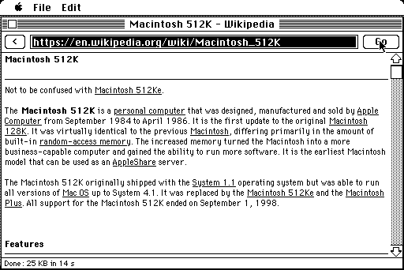
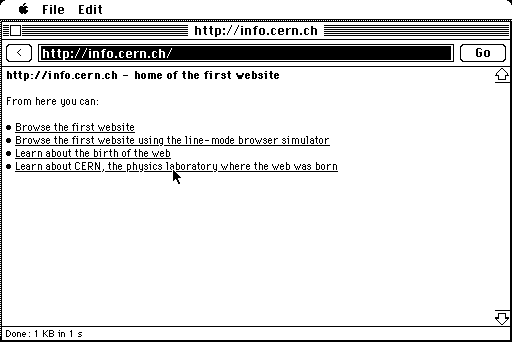
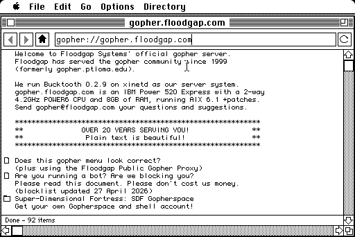
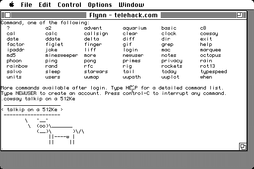
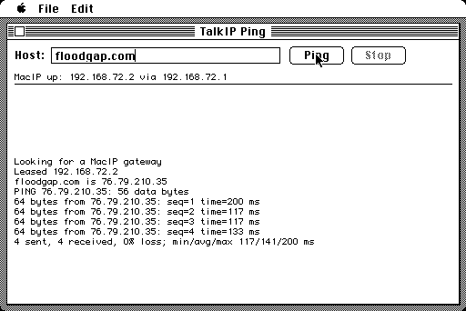
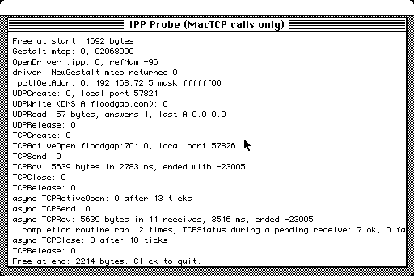

# talkip

TCP/IP for a Macintosh 512Ke (68000, 512 KB, System 6.0.8) over LocalTalk, without MacTCP.

The Mac carries IP inside AppleTalk DDP (MacIP) to a MacIP gateway, which forwards it to the LAN and the internet:

```
512Ke app ── talkip (IP/ICMP/UDP/TCP + MacIP client) ── DDP socket 72 ── .MPP (ROM AppleTalk)
   ── LocalTalk (PhoneNET) ── TashTalk 2 hat ── TashRouter ── EtherTalk ── netatalk macipgw ── IP
```

MacTCP doesn't fit in a 512Ke's RAM alongside System 6 and AppleShare, so talkip links a small stack into each
application instead. It needs no MacTCP and no hardware beyond the LocalTalk link the Mac already has. For
applications built for MacTCP, the optional **TalkIP Driver** puts the same stack behind MacTCP's `.ipp` driver
interface.

## Tools

| App | What |
|---|---|
| TalkIP Status | Opens socket 72, finds the gateway, leases an address, answers ping; shows counters and free memory |
| TalkIP Ping | ICMP echo to a host name or IP address |
| TalkIP Lookup | DNS lookups (A, PTR) through the nameserver the gateway hands out |
| TalkIP Fetch | Gopher/TCP fetch with timing, a test tool |
| TalkIP Web | An extremely basic HTTP/1.0 browser: text, headings, links. HTTPS sites through a proxy such as [macproxy](https://github.com/rdmark/macproxy_classic) |
| TalkIP Driver | An INIT that installs a MacTCP-compatible `.ipp` driver: unmodified MacTCP applications use talkip |

talkip also provides the MacTCP-style API (`_TCPCreate` … `_UDPRelease`) that the
[Geomys](https://github.com/ecliptik/geomys) (Gopher) and [Flynn](https://github.com/ecliptik/flynn) (Telnet) clients
use, so they can be built against talkip instead of MacTCP ("Lite" builds for 512 KB).

## Screenshots

A Macintosh 512Ke with System 6.0.8, reaching a netatalk `macipgw` over LocalTalk. These were taken in the
[Snow](https://github.com/twvd/snow) emulator on LToUDP; the same apps run on the real machine.

| | |
|---|---|
| <br>**TalkIP Web:** Wikipedia over HTTPS through macproxy, 25 KB in 14 s | <br>**TalkIP Web:** the first website, plain HTTP/1.0 |
| <br>**Geomys Lite:** Gopher on talkip | <br>**Flynn Lite:** Telnet on talkip |
| <br>**TalkIP Ping:** name lookup, then ICMP echo | <br>**TalkIP Driver:** a MacTCP client (IPP Probe) using `.ipp`, sync and async |

## Status

On a real Macintosh 512Ke through netatalk's macipgw:
- lease and ping, DNS, Gopher, Telnet, and Wikipedia over HTTPS through macproxy;
- the TalkIP Driver: stock MacTCP builds of Geomys and Flynn run through it unmodified. It costs about 19K of
  application heap ([docs/m8-ipp-driver.md](docs/m8-ipp-driver.md)).

The same tools through ClassicStack's MacIP gateway are compared in [docs/m7-classicstack.md](docs/m7-classicstack.md).
That comparison led to a retransmission fix upstream,
[ObsoleteMadness/ClassicStack#21](https://github.com/ObsoleteMadness/ClassicStack/pull/21).

Design, milestones and the protocol notes: [docs/PLAN.md](docs/PLAN.md),
[docs/research/macip-ddp.md](docs/research/macip-ddp.md).

## Building

Cross-compiled with [Retro68](https://github.com/autc04/Retro68) (68000, `-m68000`):

```sh
TOOLCHAIN=/path/to/Retro68-build/toolchain/m68k-apple-macos/cmake/retro68.toolchain.cmake ./scripts/build.sh
```

The output in `build/` is `.bin` (MacBinary), `.dsk` and `.APPL` files. Host-side tests for the TCP, DNS, HTML and
URL code: `make -C tests/host`. Testing was done in [Snow](https://github.com/twvd/snow) (an emulated 512Ke on
LToUDP), then on the real Mac.

## Requirements

- A Macintosh with the 128K ROM or later (512Ke, Plus, …) and System 6, on LocalTalk.
- A MacIP gateway on the same AppleTalk internet: netatalk's `macipgw` or ClassicStack in MacIP mode.

## License

ISC (see [LICENSE](LICENSE)). `include/MacTCP.h` is Apple's interface header, included for building.
